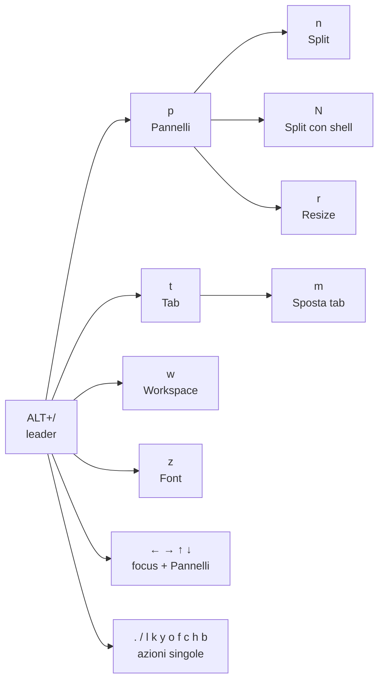

# WezTerm — scorciatoie da tastiera

Guida rapida alle scorciatoie di questa configurazione.
Tastiera di riferimento: **US**.

## Come funziona

Ci sono due tipi di scorciatoie:

- **Dirette**: una combinazione, effetto immediato (es. `CTRL+Tab`).
- **Con leader**: premi `ALT+/`, rilasci, poi premi una lettera entro **2 secondi**.

Alcune lettere del leader aprono una **modalità** (key table): resta attiva per **6 secondi**
e accetta più tasti di seguito. `Esc` o `q` la chiudono prima.

Mentre il leader o una modalità sono attivi, la barra in alto a destra mostra i tasti disponibili.



## Scorciatoie dirette

| Tasti | Azione |
|---|---|
| `CTRL+ALT+←/→/↑/↓` | Sposta il focus sul pannello vicino |
| `CTRL+Tab` | Tab successiva |
| `CTRL+SHIFT+Tab` | Tab precedente |
| `CTRL+ALT+1` … `CTRL+ALT+9` | Vai alla tab 1 … 9 |
| `CTRL+ALT+PageUp` / `CTRL+ALT+PageDown` | Scorre lo scrollback di una pagina su / giù |
| `CTRL+V` / `CTRL+SHIFT+V` | Incolla |
| `CTRL+SHIFT+C` | Copia la selezione; senza selezione il tasto passa al programma |
| `CTRL+Space` | Inviato a Neovim come sequenza CSI-u (completamento) |
| `CTRL+Enter` | Inviato al programma come sequenza CSI-u |

## Leader: `ALT+/` poi…

| Tasto | Azione |
|---|---|
| `p` | Modalità **Pannelli** |
| `t` | Modalità **Tab** |
| `w` | Modalità **Workspace** |
| `z` | Modalità **Font** |
| `←/→/↑/↓` | Sposta il focus **e** entra in modalità Pannelli |
| `.` | Command palette |
| `/` | Cerca nel testo |
| `l` | Launcher con ricerca (shell e SSH del launch menu) |
| `k` | Launcher completo |
| `y` | Seleziona un testo con le etichette e lo copia |
| `o` | Seleziona un URL con le etichette e lo apre nel browser |
| `f` | Seleziona un file (`file://…` o `percorso:riga`) con le etichette e lo apre in Neovim, alla riga indicata |
| `c` | Copy mode (selezione con la tastiera) |
| `h` | Apre lo scrollback in Neovim, in una nuova tab |
| `b` | Mostra / nasconde la barra delle tab |

## Modalità

### Pannelli — `ALT+/` → `p`

| Tasto | Azione |
|---|---|
| `←/→/↑/↓` | Sposta il focus |
| `n` | Modalità **Split** |
| `N` | Modalità **Split con shell** |
| `r` | Modalità **Resize** |
| `m` | Ingrandisci / ripristina il pannello (zoom) |
| `c` | Chiudi il pannello |

#### Split — `ALT+/` → `p` → `n`

| Tasto | Azione |
|---|---|
| `←/→/↑/↓` | Nuovo pannello in quella direzione, con la shell predefinita |
| `ALT+←/→/↑/↓` | Nuovo pannello in quella direzione, **scegliendo** la shell |

#### Split con shell — `ALT+/` → `p` → `N`

| Tasto | Azione |
|---|---|
| `←/→/↑/↓` | Nuovo pannello in quella direzione, scegliendo la shell |

#### Resize — `ALT+/` → `p` → `r`

| Tasto | Azione |
|---|---|
| `←/→/↑/↓` | Allarga il pannello di 5 celle in quella direzione |

### Tab — `ALT+/` → `t`

| Tasto | Azione |
|---|---|
| `n` | Nuova tab con la shell predefinita |
| `N` | Nuova tab scegliendo la shell |
| `←` / `→` | Tab precedente / successiva |
| `r` | Rinomina la tab |
| `m` | Modalità **Sposta tab**: `←` / `→` sposta la tab |
| `c` | Chiudi la tab (chiede conferma: `y` sì, `n` no) |
| `t` | Navigatore delle tab |

### Workspace — `ALT+/` → `w`

| Tasto | Azione |
|---|---|
| `n` | Nuovo workspace (chiede il nome) |
| `s` | Lista dei workspace con ricerca |
| `r` | Rinomina il workspace corrente |
| `←` / `→` | Workspace precedente / successivo |

Un workspace sparisce quando chiudi tutte le sue tab.

### Font — `ALT+/` → `z`

| Tasto | Azione |
|---|---|
| `↑` / `↓` | Ingrandisci / riduci il font |
| `r` | Dimensione originale |

### Copy mode — `ALT+/` → `c`

Usa i tasti predefiniti di WezTerm (stile Vim: `h j k l`, `w b`, `v` per selezionare, `y` per copiare, `Esc` per uscire).
In più: `9` porta il cursore all'ultimo carattere della riga.
I tasti principali compaiono nella barra in alto a destra.

## Mouse

| Azione | Effetto |
|---|---|
| Clic e trascina | Seleziona il testo (non copia) |
| Doppio clic | Seleziona una parola |
| Triplo clic | Seleziona una riga |
| `CTRL` + clic | Apre il link sotto il mouse. Un link `file://` o un `percorso:riga` (es. `utils/open-file.lua:12`) si apre in Neovim, una cartella in yazi; `'utente/repo'` tra virgolette apre GitHub. Vale anche dentro i programmi che catturano il mouse (Claude Code fullscreen, Neovim, less) |
| Rotella | Scorre di 6 righe |
| Clic sinistro su `+` | Nuova tab |
| Clic destro su `+` | Launcher (shell, SSH, domain) |

## La barra in alto

```text
 🚀 󰊓 zoom   █ 1 zsh ▐█ 2 nvim  ● ▐ +        Trinity        |default|lavoro|
 └─sinistra─┘ └──────── tab ────────┘         └─ cwd ─┘       └ workspace ┘
```

| Zona | Cosa mostra |
|---|---|
| Sinistra | razzo = leader attivo · `zoom` = pannello ingrandito |
| Tab | numero, programma, ● = output non letto, icona server = VPS |
| Destra | tasti della modalità attiva, **oppure** ssh + cartella corrente al centro e i workspace (se più di uno) |

## Tasti lasciati liberi per altri programmi

Questi tasti **non** sono usati da WezTerm e arrivano a zellij, Neovim e alla shell:

`ALT+.` (leader di zellij su Windows) · `ALT+w` · `ALT+t` · `ALT+e` · `ALT+f` · `ALT+1…9` · `ALT+←/→/↑/↓` · `ALT+PageUp/PageDown` · `ALT+SHIFT+←/→/↑/↓` (usato dal sistema) · `CTRL+SHIFT+Space`

Le scorciatoie di zellij su Windows sono in `C:\Users\en27553\AppData\Roaming\Zellij\config\README.md`.

## Dove modificare

La config è in `~/.config/wezterm` ed è gestita da chezmoi: dopo una modifica, `chezmoi re-add ~/.config/wezterm`
e commit nel repo chezmoi. Linux la legge da lì; Windows tramite `WEZTERM_CONFIG_FILE`
(impostata dallo script chezmoi `run_onchange_after_windows-wezterm-config.sh.tmpl`).
Le differenze tra Windows e Linux (Neovim, yazi, cartella temporanea, chiave SSH) passano da `utils/platform.lua`.

| Cosa | File |
|---|---|
| Scorciatoie e modalità | `config/bindings.lua` |
| Durata di leader e modalità | `config/bindings.lua` → `LEADER_TIMEOUT`, `TABLE_TIMEOUT` |
| Testi dei suggerimenti nella barra | `events/tabline/config.lua` → `hints`, `leader_hint` |
| Colori, regole e icone della barra | `events/tabline/config.lua` |
| Voci del launcher | `config/launch.lua` |
| Apertura dei file in Neovim (`ALT+/` → `f`, link `file://`) | `utils/open-file.lua` |
| Connessioni SSH (VPS, ArchLinux) | `config/domains.lua`, cifrato con age nel repo: modificalo con `chezmoi edit ~/.config/wezterm/config/domains.lua` |

Dopo una modifica alla barra:

```bash
cd ~/.config/wezterm && luajit test/tabline_test.lua
cd ~/.config/wezterm && luajit test/open_file_test.lua   # dopo una modifica a utils/open-file.lua
```
