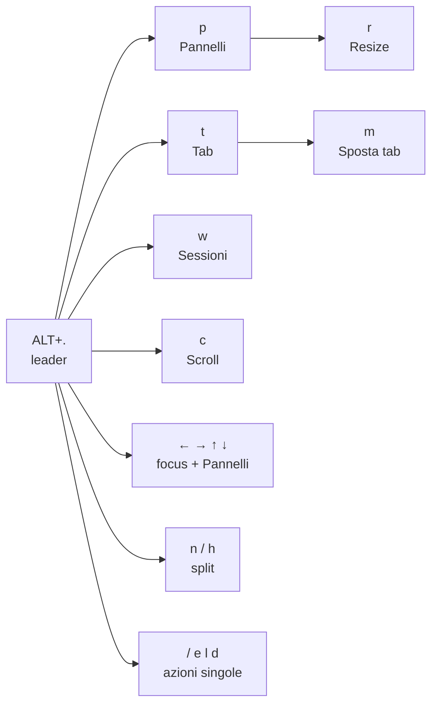

# Zellij — scorciatoie da tastiera

Guida rapida alle scorciatoie di questa configurazione (`config.kdl`).
Lo schema segue quello di WezTerm (`~/.config/wezterm/README.md`), con un leader diverso.
Tastiera di riferimento: **US**.

## Come funziona

Ci sono due tipi di scorciatoie:

- **Dirette**: una combinazione, effetto immediato (es. `ALT+→`).
- **Con leader**: premi `ALT+.`, rilasci, poi premi una lettera.

Il leader e alcune lettere aprono un **modo**: un modo cambia il significato dei tasti.
A riposo Zellij è nel modo base `locked`: tutti i tasti arrivano ai programmi, tranne `ALT+.` e le scorciatoie dirette.
In WezTerm le key table si chiudono dopo 6 secondi; in Zellij un modo resta attivo finché premi `Esc`, `q` o `Invio`.
In un modo, i tasti senza azione **non** arrivano al programma.
Per questo le azioni finali (split, chiudi, nuova tab) tornano da sole al modo base.

La barra in alto mostra il nome del modo attivo: `LOCKED` è la base, `NORMAL` è il leader, `MOVE` è lo spostamento delle tab.
Se dopo `ALT+.` aspetti un attimo (300 ms), in basso compare un riquadro con i tasti del modo attivo e la loro descrizione, come which-key in Neovim.
Il titolo del riquadro mostra il modo e i tasti per uscire; `+` indica un tasto che apre un altro modo.
Il riquadro segue i modi successivi e si chiude quando torni alla base: vedi [Riquadro dei tasti](#riquadro-dei-tasti).



## Scorciatoie dirette

Regola: dove WezTerm usa `CTRL+ALT+tasto`, Zellij usa `ALT+tasto`.

| Tasti | Azione | In WezTerm |
|---|---|---|
| `ALT+←/→/↑/↓` | Sposta il focus sul pannello vicino. Dal pannello sul bordo, `←`/`→` passano alla tab vicina | `CTRL+ALT+←/→/↑/↓` |
| `ALT+1` … `ALT+9` | Vai alla tab 1 … 9 | `CTRL+ALT+1` … `CTRL+ALT+9` |
| `ALT+PageUp` / `ALT+PageDown` | Scorre il pannello di una pagina. Zellij entra nel modo scroll e torna al modo base quando arrivi in fondo | `CTRL+ALT+PageUp` / `CTRL+ALT+PageDown` |
| `ALT+f` | Mostra / nasconde i pannelli floating (sopra gli altri) | — |
| `ALT+s` | Picker delle sessioni **zeshij**, come sesh: sessioni Zellij, `sesh.toml`, zoxide e layout. `Invio` connette, `Tab` mostra la preview, `Esc` chiude | `ALT+/` → `w` → `s` (lista dei workspace) |

## Leader: `ALT+.` poi…

| Tasto | Azione |
|---|---|
| `p` | Modo **Pannelli** |
| `t` | Modo **Tab** |
| `w` | Modo **Sessioni** (come i workspace di WezTerm) |
| `c` | Modo **Scroll** (come la copy mode di WezTerm) |
| `←/→/↑/↓` | Sposta il focus **e** entra nel modo Pannelli |
| `n` | Split verticale: nuovo pannello con la zsh, a destra |
| `h` | Split orizzontale: nuovo pannello con la zsh, sotto |
| `/` | Cerca nel testo del pannello |
| `e` | Apre lo scrollback in Neovim, all'ultima riga |
| `l` | Layout manager: scegli un layout (zsh, cmder); `Invio` lo apre in una nuova tab |
| `d` | Detach: stacchi il terminale, la sessione resta attiva |

## Modi

### Pannelli — `ALT+.` → `p`

| Tasto | Azione |
|---|---|
| `←/→/↑/↓` | Sposta il focus (resti nel modo) |
| `r` | Modo **Resize** |
| `m` | Ingrandisci / ripristina il pannello (zoom) |
| `c` | Chiudi il pannello |
| `e` | Sposta il pannello tra floating e fisso |
| `w` | Mostra / nasconde i pannelli floating |
| `i` | Tiene il floating sempre in primo piano (pin) |
| `s` | Nuovo pannello impilato sopra quello attivo (stacked) |
| `z` | Mostra / nasconde i bordi dei pannelli |
| `p` | Focus al pannello successivo |

#### Resize — `ALT+.` → `p` → `r`

| Tasto | Azione |
|---|---|
| `←/→/↑/↓` o `h/j/k/l` | Allarga il pannello in quella direzione |
| `H/J/K/L` | Restringe il pannello in quella direzione |
| `+` o `=` / `-` | Allarga / restringe |

### Tab — `ALT+.` → `t`

| Tasto | Azione |
|---|---|
| `←` / `→` | Tab precedente / successiva (resti nel modo) |
| `n` | Nuova tab con la zsh (layout `zsh.kdl`) |
| `N` | Layout manager: nuova tab scegliendo il layout |
| `r` | Rinomina la tab |
| `m` | Modo **Sposta tab**: `←` / `→` sposta la tab |
| `c` | Chiudi la tab, **senza** conferma |
| `[` / `]` | Sposta il pannello nella tab a sinistra / a destra |
| `b` | Sposta il pannello in una tab nuova |
| `s` | Scrive in tutti i pannelli della tab (sync); ripeti per spegnere |
| `Tab` | Torna all'ultima tab usata |

### Sessioni — `ALT+.` → `w`

| Tasto | Azione |
|---|---|
| `s` | Session manager: lista con ricerca, nuova sessione, rinomina |
| `d` | Detach |
| `CTRL+q` | Chiude la sessione e tutti i suoi programmi |
| `a` | Informazioni su Zellij |
| `c` | Configurazione |
| `p` | Plugin manager |

### Scroll e ricerca — `ALT+.` → `c`

| Tasto | Azione |
|---|---|
| `↑/↓` o `k/j` | Scorre di una riga |
| `PageUp/PageDown`, `←/→`, `h/l`, `CTRL+b/f` | Scorre di una pagina |
| `u` / `d` | Scorre di mezza pagina |
| `s` | Cerca (dalla base: `ALT+.` → `/`) |
| `e` | Apre lo scrollback in Neovim |
| `CTRL+c` | Torna in fondo e al modo base |
| `ALT+.` | Leader. Serve quando il pannello è scorso in alto: lì Zellij resta nel modo scroll |

Durante la ricerca: `n` / `p` risultato successivo / precedente, `c` maiuscole e minuscole, `w` ricerca circolare, `o` parola intera.

Mentre cerchi, i pannelli hanno la cornice: in alto vedi `Enter search...`, poi il testo che scrivi (`SEARCHING: …`).
Zellij scrive la ricerca solo nella cornice, e a riposo le cornici sono spente (`pane_frames false`): le accende e le spegne il plugin del riquadro dei tasti.
Quando la cornice compare o sparisce, i pannelli cambiano dimensione di 2 righe e 2 colonne.
In un pannello quasi vuoto, uscire con `q`, `Esc` o `Invio` può ripetere le prime 2 righe sullo schermo; con `CTRL+c` no.

Per copiare, seleziona il testo con il mouse: Zellij lo copia negli appunti quando rilasci il tasto.

## Differenze da WezTerm

| WezTerm (`ALT+/`) | Zellij (`ALT+.`) | Motivo |
|---|---|---|
| `p` → `n` → freccia | `n` (destra) o `h` (sotto) | Zellij crea il pannello nuovo solo a destra o sotto |
| `p` → `N`, `t` → `t`, `k` | — | Zellij non ha un launcher né un navigatore delle tab |
| `h` (scrollback in Neovim) | `e` | `h` è lo split orizzontale |
| `z` (font), `.` (palette), `b` (barra) | — | Sono funzioni di WezTerm: usa `ALT+/` |
| `y`, `o`, `f` (selezione con etichette) | — | Usa `ALT+/` di WezTerm: funziona anche sopra Zellij |
| `t` → `c` chiede conferma | chiude subito | Zellij non ha una conferma |
| key table che si chiude dopo 6 s | modo senza scadenza | Esci con `Esc`, `q` o `Invio` |

## Tasti lasciati ai programmi

A riposo (modo `locked`) Zellij usa solo `ALT+.`, `ALT+←/→/↑/↓`, `ALT+1…9`, `ALT+PageUp/PageDown` e `ALT+f`.
Non c'è un blocco totale: questi tasti restano sempre a Zellij.
Tutti i `CTRL+lettera` arrivano a zsh, Neovim e Claude Code (es. `CTRL+w`, `CTRL+t`, `CTRL+o`, `CTRL+g`).
Arrivano ai programmi anche `ALT+w`, `ALT+t`, `ALT+p`, `ALT+o` e `ALT+v`, usati da Claude Code.

## Riquadro dei tasti

Il riquadro è il plugin `zellij-which-key`: sorgente Rust in `plugins/zellij-which-key/`, file compilato `plugins/zellij-which-key.wasm`.
Storico delle modifiche e task aperte: `plugins/zellij-which-key/task.md`.

- Compare se resti in un modo per `timeoutlen` ms (300), come which-key: se digiti la sequenza di corsa, non compare.
- Una volta aperto, segue i modi successivi (`p`, `t`, `w`, `c`, la ricerca) senza ritardo. Si chiude quando torni alla base.
- `timeoutlen` sta nel blocco del plugin in `config.kdl`; con `0` il riquadro compare subito.
- Non compare con `ALT+PageUp`/`ALT+PageDown`, né mentre scrivi una ricerca o il nome di una tab.
- Durante la ricerca il plugin accende le cornici dei pannelli, per mostrare il testo cercato: vedi la sezione "Scroll e ricerca".
- Non mostra i tasti diretti (`ALT+…`): fanno la stessa cosa in ogni modo.
- I tasti con la stessa descrizione stanno su una riga, per esempio `← h  allarga ←`.
- Le descrizioni sono automatiche. Per cambiarne una, aggiungi una riga nel blocco del plugin in `load_plugins` (`config.kdl`), per esempio `"normal n" "split a destra (zsh)"`. Il formato è `"<modo> <tasto>" "<testo>"`, con il tasto scritto come in `bind`.
- Le modifiche al blocco valgono dalla sessione successiva.
- La prima volta Zellij chiede i permessi del plugin: rispondi `y`.

### Modificare il plugin

Per usare il plugin non serve compilarlo: il `.wasm` è nel repo dei dotfiles.
Per cambiare il codice serve Rust con il target `wasm32-wasip1`.

| Macchina | Cosa serve | Stato al 2026-10-20 |
|---|---|---|
| PC Windows (MSYS2 UCRT64) | `rustc`/`cargo` UCRT64 e il pacchetto pacman `mingw-w64-ucrt-x86_64-rust-wasm` (stessa versione di `rustc`) | installati (1.98.1); crate già scaricati in `~/.cargo/registry` |
| Linux con rustup | `rustup target add wasm32-wasip1` | non controllato |
| Arch con i pacchetti | `pacman -S rust rust-wasm` | non controllato |

Controlla l'ambiente:

```bash
rustc --version && ls "$(rustc --print sysroot)/lib/rustlib" | grep wasm32-wasip1
```

Ciclo dopo una modifica:

```bash
cd ~/.config/zellij/plugins/zellij-which-key
CARGO_HTTP_CHECK_REVOKE=false cargo build --release
cp target/wasm32-wasip1/release/zellij-which-key.wasm ../zellij-which-key.wasm
chezmoi status   # file cambiati rispetto al repo dei dotfiles
chezmoi re-add ~/.config/zellij/plugins/zellij-which-key.wasm ~/.config/zellij/plugins/zellij-which-key/src/*.rs
```

- `src/*.rs` e il `.wasm` non sono template: modificali in `~/.config/zellij` e riportali nel repo con `chezmoi re-add`. Poi fai il commit nel repo (`chezmoi cd`).
- `CARGO_HTTP_CHECK_REVOKE=false` serve solo dietro il proxy aziendale, che blocca il controllo di revoca dei certificati.
- La cartella `target/` contiene i file intermedi della build (circa 380 MB) e chezmoi la ignora. Senza `target/` la prima build ricompila 132 crate in circa 4,5 minuti; le successive durano circa 7 secondi.
- Sul PC Windows la `target/` della build precedente è in `%APPDATA%\Zellij\config.pre-chezmoi.bak\plugins\zellij-which-key\target`. Per riusarla:

  ```bash
  mv /c/Users/en27553/AppData/Roaming/Zellij/config.pre-chezmoi.bak/plugins/zellij-which-key/target ~/.config/zellij/plugins/zellij-which-key/
  ```

- Il `.wasm` vale per Zellij 0.45.1 (`zellij-tile = "=0.45.1"` in `Cargo.toml`). Con un'altra versione di Zellij cambia la versione in `Cargo.toml` e ricompila.
- Architettura, regole del contenuto e prove dal vivo: `plugins/zellij-which-key/task.md` e `tasks/`. Leggi `tasks/T0-plugin-base.md` prima di cambiare il codice.

## Note

- La base è `locked` (`default_mode "locked"`, lo schema "Unlock First" di Zellij) perché la barra apre il riquadro di aiuto solo per il leader nel modo `normal`. Con il leader nel modo `tmux` il riquadro non compare.
- Su Windows `n` e `h` aprono la zsh UCRT64, come il layout `zsh.kdl`. Su Linux aprono la shell di default, come il layout.
- `ALT+f` (il primo floating) e `p` → `s` aprono invece la shell di default di Zellij. Se avvii Zellij dal menu di WezTerm è `cmd.exe`, perché `default_shell` non è impostato.
- Su Linux e sulla VPS `ALT+.` → `e` apre `nvim` del `PATH`, e il layout `cmder` non c'è.
- Zellij rilegge `config.kdl` da solo, entro un secondo: le sessioni aperte usano subito i tasti nuovi. Non tutte le opzioni si ricaricano: `pane_frames`, per esempio, vale dalla sessione successiva.

## Dove modificare

La config è nel repo dei dotfiles, gestito da chezmoi: source `~/.local/share/chezmoi/dot_config/zellij/`, destinazione `~/.config/zellij`.
Modifica il source, poi esegui `chezmoi apply`: una modifica fatta solo nella destinazione sparisce al prossimo apply.
`config.kdl` e `layouts/zsh.kdl` sono template (`.tmpl`) con un blocco per Windows e uno per Linux. Aprili con `chezmoi edit ~/.config/zellij/config.kdl`.
Su Windows Zellij legge `%APPDATA%\Zellij\config`: è una junction verso `~/.config/zellij`, creata da chezmoi.

| Cosa | File nel source |
|---|---|
| Scorciatoie e modi | `config.kdl.tmpl` → blocco `keybinds` |
| Editor dello scrollback (`ALT+.` → `e`) | `config.kdl.tmpl` → `scrollback_editor` |
| Shell delle tab nuove | `layouts/zsh.kdl.tmpl` |
| Descrizioni del riquadro dei tasti | `config.kdl.tmpl` → blocco `load_plugins`, voce `zellij-which-key.wasm` |
| Codice del riquadro dei tasti | `plugins/zellij-which-key/src/` |
| Percorsi di MSYS2 (solo Windows) | variabili in testa a `config.kdl.tmpl` e `layouts/zsh.kdl.tmpl`, ricavate da `.chezmoi.homeDir` |

Dopo una modifica, controlla il file. Su Windows:

```bash
ZELLIJ_CONFIG_DIR='C:/Users/en27553/AppData/Roaming/Zellij/config' zellij setup --check
```

Su Linux basta `zellij setup --check`. Il file è valido se l'output contiene `[CONFIG FILE]: Well defined.`.
